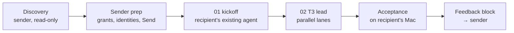

# Onboarding a colleague onto T3 (sender playbook)

Intent: the next onboarding is a short parameter block plus this recipe, not a new 300-line prompt.
The sender's agent discovers and prepares; the recipient's agents install and prove it on their machine.
Bootstrap mechanics stay in [SKILL.md](SKILL.md); this file adds the sender side, the package and the lanes.

## 1. Discovery (sender)

Input: person + repositories. Run [discovery.md](discovery.md): parallel read-only clusters → an access
manifest (env, CLIs, credentials, destinations, own/shared/local/never), proposed grants, and the
decisions only the sender can make. Facts about the person (OS, accounts, language, role) come from the
sender's colleague notes, never assumptions.

## 2. Sender prep

- Grants and identities the manifest proposes (repo access, product roles, scoped cloud identity), each
  after the sender's explicit go; consequential trade-offs (data visibility, destructive rights, account
  terms) go back to the human as decisions.
- Shared secrets: one Bitwarden Send ([bitwarden receive.md](../../skills/bitwarden/receive.md)): a
  ≤600-byte JSON text bundle the receiver installs with `bw-receive` (staging file, then the lead moves
  each value to its destination). Bigger → a file Send. Never in the ZIP, never in chat.
- Whatever the recipient can create with their own login (subscriptions, OAuth tokens, CLI logins,
  personal API tokens) stays out of the Send: fewer shared bearers, per-person revocation.

## 3. The package (ZIP, secret-free)

| File | Content |
|---|---|
| `START-HERE.md` | ≤10 lines in their language: which app/mode to open, which file to attach, what they'll be asked to do by hand |
| `01-kickoff.md` | run in an agent that already has a shell: Claude Desktop **Code tab, Local environment** (ordinary chat cannot run commands), Codex, or `claude` in Terminal. Executes [SKILL.md](SKILL.md) "Fresh machine" + "Detect before creating" up to: T3 open, one provider answering a real turn, setup repo pushed with the sender invited. Then tells the user to open T3 and paste `02` |
| `02-t3-lead.md` | one autonomous T3 lead: lanes below, human-touch queue, checkpoints, acceptance |
| `<person>.md` | the parameter block: identity, language, dev level, GitHub user, emails/mailboxes, repos (owner/name, default branch, deploy channel), providers/accounts, router routes, guards |
| `access-manifest.md` | names only: credential → purpose → source → destination → validation → expiry/revocation |
| `acceptance.md` | the matrix from [verification.md](verification.md), sender column pre-filled |
| `templates/` | wrapper skills or config the recipient cannot read elsewhere (private repos they lack access to) |

Prompts point at skill files that exist on disk after the kickoff's clone; they don't restate them.
Scan the ZIP for secrets before delivery (`rg -i 'token|secret|password|key='` and the bundle's own values).

## 4. Lanes in the T3 lead

First, serially: one working provider, GitHub identity, private setup repo, checkpoint file
([verification.md](verification.md#checkpoints)). Then in parallel (native sub-agents or `delegate_task`):

| Lane | Scope |
|---|---|
| A · toolchain + apps | brew/mise/uv/pnpm/bundler/colima per repo; clone into `~/code/<owner>/<repo>`; safe local boot per [verification.md](verification.md#local-app-feedback-loop) |
| B · accounts + integrations | second provider, Workspace OAuth, product CLIs, cloud identity, Send install |
| C · workflow | shared skills + skills-refresh, global prompt merge, Auto mode, router + wrapper, browser profiles |

- **Only the lead** edits shared state (shell rc, `~/.t3/userdata/settings.json`, global skill links, brew
  installs); workers report the change they need.
- **Human-touch queue**: Mac password, browser logins/2FA, consent screens, Touch ID: one at a time, each
  announced in plain words in their language; other lanes keep running while one waits.
- **Resume**: a new session reads the checkpoint file, rechecks prerequisites, continues. Never repeat a
  one-view Send fetch, a credential issuance or an OAuth mint without checking the checkpoint first.

## 5. Checklist (what onboardings forget)

- Repo access per repo, verified with `gh api repos/<o>/<r>/collaborators/<user>/permission`; outside
  collaborators don't inherit org base permissions.
- Deploy channels per repo (push to `main` = production?) and whether server-side branch protection
  exists; if not, the guard lives in the person's global prompt and Auto-mode environment.
- Subscription accounts: one person per consumer seat (Claude/ChatGPT terms forbid sharing); team seats
  or their own login. A setup-token is model-only, lasts a year and hides usage from routing.
- Never copy the sender's env files: they hold production DSNs, deploy keys and
  `CLAUDE_CODE_OAUTH_TOKEN`, which outranks the recipient's own login. Build theirs from an allowlist.
- One OAuth token per (account, machine): the recipient mints their own Workspace token; a copied
  refresh token can't be revoked without cutting everyone off.
- Product roles: check what a role really exposes (e.g. "admin sees every mailbox") before granting;
  verify the negative (a forbidden id returns 404/403) on their machine.
- Shared historical tokens: inventory who depends on them before revoking anything.
- Cloud: a dedicated scoped identity, simulated before issuance, browser login over long-lived keys;
  state honestly what a shell on the box still allows (data deletion, secrets in containers).
- Local apps: demo/fake seed only, mail and jobs off, loopback DB, web process only.
- Offboarding register: every grant/credential with where to revoke it (in the sender's private notes).
- Skills-refresh scheduled; harness memory off; T3 browser profiles for their logins.
- Final usability check: one real task from their job, end to end.
- Feedback block back to the sender; the sender arms a follow-up until it arrives.
