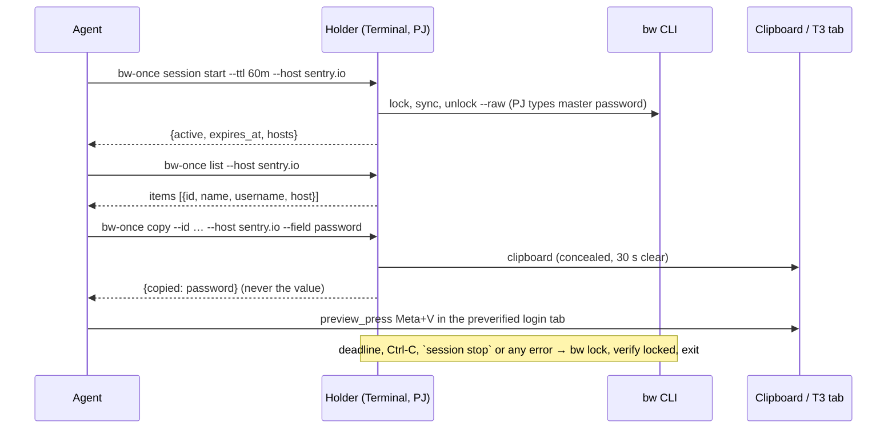

# Time-boxed session (`bw-once session`)

Intent: PJ unlocks once ("I can give a one-hour token"), an agent then reads which login exists for a host and
copies one credential into a browser login form, several times, without a Terminal round-trip per request. The
session key never reaches the agent, a file, an env dump or a transcript; the vault locks itself at expiry.

## Why a holder process, not a `BW_SESSION` variable

`bw unlock --raw` prints a fresh random AES key that wraps the user key stored in
`~/Library/Application Support/Bitwarden CLI/data.json` (`__PROTECTED__<userId>_user_auto`). Anyone with that
key plus `data.json` reads the whole vault. Bitwarden gives it **no lifetime**: "Session keys are valid until
invalidated using `bw lock` or `bw logout`"; staff: "You are responsible for maintaining your session key"
(cli#107, `--ttl` request still open 2026-09). `bw lock` removes the protected key, so every earlier session key
dies; a new `bw unlock` does the same. A session also has **no scope**: no flag limits it to a collection or
item. Hence:

- the holder keeps the key in its own memory and enforces the deadline by running `bw lock` (the only real
  revocation); no Keychain item (no expiry attribute), no launchd plist, no `export BW_SESSION`;
- the holder, not `bw`, enforces scope: exact hosts, list/copy only, one field per copy, result = metadata.

Sources: [CLI docs](https://bitwarden.com/help/cli/) ·
[unlock.command.ts](https://github.com/bitwarden/clients/blob/main/apps/cli/src/key-management/commands/unlock.command.ts) ·
[lock.command.ts](https://github.com/bitwarden/clients/blob/main/apps/cli/src/auth/commands/lock.command.ts) ·
[session key wraps the user key](https://sdk-api-docs.bitwarden.com/bitwarden_unlock/session_key/index.html) ·
[CLI session expiration thread](https://community.bitwarden.com/t/cli-session-expiration/43611) ·
[secrets on disk](https://community.bitwarden.com/t/bitwarden-cli-usage-can-easily-result-in-secrets-stored-on-disk/80009).

## Flow

1. **Mint** (PJ): the agent runs `bw-once session start --ttl 60m [--host a.example.com …]`; a real macOS
   Terminal opens, shows the request (ttl, hosts) and runs official `bw unlock`. PJ types the master password
   there. Default 60 min, hard cap 240. At least one `--host` is required (2026-10-18: an unscoped session
   would let a prompt-injected agent pull any login one host at a time).
2. **Hold**: the holder keeps `BW_SESSION` in process memory and in the env of its own `bw` subprocesses only,
   holds the `bw-once` mutex (no concurrent per-request flow can relock), listens on
   `~/.cache/bw-once/session.sock` (dir 0700, socket 0600) and prints one audit line per request in the
   Terminal PJ can watch. It never writes the key, a result or a secret to disk.
3. **Use** (agent): the normal commands pick the socket automatically when it exists, else fall back to the
   per-request Terminal flow: `bw-once list --host <exact host>` → pick the item by username,
   `bw-once copy --id <uuid> --host <host> --field username|password|totp` → clipboard, paste into the
   form, `bw-once clear`. `bw-once session status` shows remaining seconds; `bw-once session stop` locks early.
4. **Lock**: at the deadline (or stop, Ctrl-C, SIGTERM, any failure) the holder runs `bw lock`, verifies
   `status == locked`, forgets the key and exits; `session stop` answers `locked: true` only after that check. Kill switch from anywhere: `bw lock` in any shell also
   invalidates the key; the holder then fails closed on its next call.

## Getting the secret into the login form without model text

- T3 browser: focus the field (`preview_click`), then `preview_press {key:"v", modifiers:["Meta"]}`. T3
  synthesises the paste from the system clipboard in its main process; the value never enters the model
  (verified 2026-10-06 on text and password inputs; a human Cmd+V may land in another tab,
  [t3code #13897](https://github.com/pingdotgg/t3code/issues/13897)). Verify URL/host of the tab
  **before** the copy, never `preview_evaluate` the field value or snapshot a revealed field afterwards.
- PJ's Chrome over CDP (`playwright-cli attach --cdp=chrome`): `press Meta+V` on the focused field of your
  own background tab works the same way; `chrome-devtools fill` would need the value as an argument, so it is
  not allowed for secrets.
- Username is not secret: `copy --field username` + paste keeps the pattern uniform, or read it from the
  `list` output.
- TOTP: `--field totp` delivers the current 6-8 digit code, never the seed.
- Clipboard clears after 30 s; paste promptly, one copy per field, `bw-once clear` right after the paste.
- One login without TOTP needs no session: `copy --host … --username … --field password` is one unlock.

## Browser context for agent logins

T3's `incognito` profile is in memory only, but **one partition per T3 app, shared by every thread's incognito
tabs** (T3 0.1.2 `resolvePartitionScope`: scope = environment + profile, no thread/tab), including threads
reading untrusted pages. Still the right place for an agent login: it holds no other logins and dies when T3
quits. Never log in or out in Work/Personal for this: their cookies serve other threads.

1. `preview_open {profileId:"incognito", reuseExistingTab:false}` on the login URL; own tab, verify host.
2. One-unlock copy, paste, `bw-once clear`, submit; verify the account on the page.
3. Do the task, then the site's own logout in the same tab; verify a signed-in page now asks to log in;
   `t3_preview_close`. Logout also runs after a failed task. Logout itself failed → report: the session lives
   until T3 quits or PJ uses Settings → Integrations → Incognito → Clear data (also drops other threads'
   incognito tabs, so never silently).

A logged-out page proves the site session ended, not that the partition is gone. Native per-tab ephemeral
contexts or a `secretRef` field fill don't exist in T3 0.1.2 (`request_secret` refs feed only webhook
signatures); both would be T3 features, not local code.

## Verified live 2026-10-23

Stack Overflow login without a session: one `copy --host … --username … --field password` (one Terminal,
one master password), `preview_click` the password field, `preview_press Meta+V` (only `value.length`
checked), `bw-once clear` → `cleared: true`, submit, account verified on the page; site logout in the same
incognito tab (SO's "log out everywhere" left unchecked), protected page then redirected to login; tab closed,
CLI locked. Gotchas: the first try's visible prompt mentioned the
master password, so it got typed there (now hidden + discarded); a wrong password showed only "operation failed"
(now names the step).

## Verified live 2026-10-14

One 60-minute session with `--host sentry.io --host mapbox.com --host account.mapbox.com`: 3 `list` + 7 `copy` calls
served from memory, four Sentry logins and one Mapbox login via `preview_press Meta+V`, `session stop` locked the
CLI (`bw status` = locked) after ~30 minutes. Gotchas: the first `session start` timed out after 180 s because PJ was
not at the Terminal yet (ask first, then start); a T3 automation blip between `copy` and the paste means the 30 s
clipboard window is gone, so re-copy before retrying; `Meta+A` then `Meta+V` recovers a field that caught a stray
character. Mint it only after `bw status` shows `locked` with a userEmail: a refresh token that expired after months
without sync logs the CLI out during the pre-unlock sync, and only PJ can `bw login` again (YubiKey, `--method 3`).

## Never

`bw export`, `bw list items` output (the helper reads it unfiltered internally and emits only exact-host metadata), `bw get item` dumps, `bw get password` to stdout, reading
`pbpaste`/the clipboard, passing a secret to `preview_type`/`fill`/any text-entry tool, screenshotting a
revealed password field, TOTP seeds or notes, `--passwordenv`, a `--passwordfile` other than bw-once's own Touch ID pipe, copying `data.json`, setting
`BW_SESSION` in any shell/env file/repo, or asking PJ to paste a key into the chat. A session is exposure
reduction with consent, not containment against malicious same-user code (it can still read process memory
or the clipboard).

## Alternatives considered

- **Bitwarden Secrets Manager (`bws`)**: access tokens with an expiry and project scope are the native answer
  for machine secrets, but a secret is a key/value, not a login with URIs/TOTP, so every credential would be
  duplicated and drift. Keep for CI, not for "log in as PJ" ([access tokens](https://bitwarden.com/help/access-tokens/)).
- **Browser extension autofill**: no automation API; the Cmd+Shift+L shortcut needs focus in Chrome, which
  the browser rules forbid ([URI match detection](https://bitwarden.com/help/uri-match-detection/)).
- **Keychain item with expiry**: generic-password items have no expiration attribute; the reader would have
  to enforce it anyway, so the holder is simpler and leaves nothing on disk.
- **Biometric CLI unlock**: shipped in CLI 2026.10.0 ([PR #22448](https://github.com/bitwarden/clients/pull/22448)),
  needs Desktop ≥ 2026.9.0 with Touch ID on for the same account and an interactive unlock (the holder's `bw unlock` qualifies), but is
  dark-launched behind server flag `biometrics-sdk-ipc` (false 2026-10-18). Touch ID would replace only the
  password at mint; the session stays whole-vault, so the holder's scope/TTL rules remain the control.
