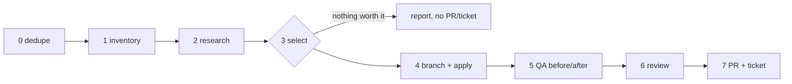

# Dependency update (core)

North star: **the stack stays supported, patched and boring to maintain.** Each run takes the
upgrades that buy security, support or a fix we need, as one bounded and coherent change a human
can test and merge in one sitting. Version churn is not a goal: "newer" alone is no reason, and
"nothing worth doing this month" is a good outcome.

**Endpoint: a tested PR + one ticket for the named tester. Never merge, deploy, push the base
branch or release.** That holds even where the repo's own rules say "merge and ship": in this
workflow the human merge is the approval gate.

**The wrapper owns** (never here): repo, base and release branches, which manifests/runtimes/infra
are in scope, deliberately frozen packages, in-flight migrations and the skills that own them, QA
skill + commands + safe environment, reviewer, tracker wrapper/list/status/assignee/language,
deploy and staging rules. Missing field → stop and report; never guess an assignee or a gate.

## 0. Dedupe and baseline

- Open PRs, branches and tracker tasks touching the same **dependency family and target line**
  (not the month; any author). Another author's work: leave it alone, skip that family, mention it.
  An earlier run's PR still open: no second one; a new Must goes onto that branch (QA rerun,
  evidence refreshed), otherwise one comment on its ticket and stop. Repeat this check right
  before publishing: someone may have opened one meanwhile.
- **Baseline = the wrapper's base branch on origin**, fetched now; never a local checkout, an old
  feature branch or a version written in a doc. An upgrade on the base not yet on the release
  branch blocks overlapping changes (same family, its coupled packages, runtime) until it ships;
  unrelated Musts still go.
- Work in a fresh worktree or clone from `origin/<base>`; never switch, stash or reset a shared checkout.

## 1. Inventory (what we actually run)

Locked versions, not ranges: every lockfile, runtime pin (version files, Dockerfile `FROM`, CI
setup actions, PaaS stack), base images, database/cache engine versions in dev, CI **and**
production (read-only), deploy tooling. Mismatches between those places are findings.
Commands per ecosystem: [references/ecosystems.md](references/ecosystems.md).

## 2. Research (primary sources, every run)

For each candidate: vendor release notes/changelog, security advisories (GHSA, OSV, the
ecosystem's advisory DB), the vendor's support/EOL policy page (endoflife.date as a pointer, the
vendor as proof). Note URL + date per claim. Does the advisory hit code we use? Is the fixed
version in our current line?

## 3. Select (bounded, coherent)

| Take | Examples |
| --- | --- |
| **Must** | advisory affecting us; our line loses support within ~3 months; a fix for a bug we hit; required by another Must |
| **Should** (critical deps only) | patch/minor in our line with relevant fixes; runtime patch release; pinning an unpinned base image tag (with reason) |
| **Skip** (list in the PR with why) | major without a Must reason; dev-only churn; packages the wrapper freezes; pin changes without rationale; anything owned by an in-flight migration |

- Group coupled packages (framework family, a gem and its plugins, runtime + base image + CI pin).
- **At most two PRs per run, one ticket:** the routine set, plus one major group only when it is a
  Must (own PR, own review). Other majors become one-line proposals in the ticket ("next: X 5 → 6,
  why, effort"). A prerequisite that turns into a migration stops the expansion: propose it.
- Nothing selected → no branch, PR or ticket; the run ends with a 3-line report (checked, why
  nothing, next date that matters, e.g. an upcoming end of support).

## 4. Branch and apply

Branch `deps/YYYY-MM` from `origin/<base>`. Use the ecosystem's conservative update for exactly
the selected packages (lockfile diff = the selection, nothing else); bump every pin of a runtime
together. Fix deprecations/breakages the upgrade causes; no unrelated refactors. One commit per
coupled group; message says what and why (advisory id / support date). Before the first push,
read the CI/deploy workflow triggers: a branch push must not deploy anything.

## 5. QA: prove it, before and after

1. Run the wrapper's checks on `origin/<base>` first (baseline), then on the branch: tests, lint,
   build, the QA skill's critical flows. A failure on both is pre-existing; only on the branch is ours.
2. Add upgrade-specific checks from the release notes: the changed behaviour or deprecation on the
   paths we use (a page, a job, an API call, an asset build, a container boot).
3. UI possibly affected (asset pipeline, admin framework, CSS/JS) → same screens before/after
   ([ui-before-after](../ui-before-after/SKILL.md) when installed); screenshots go on the ticket.
4. Synthetic data and the wrapper's safe environment only: no production writes, no mail/SMS to
   customers, no shared-staging deploy unless the wrapper allows it and coordination is done.
   Skip QA steps whose precondition is a merge or deploy; they become the tester's steps.
5. Parity gaps (test DB major ≠ production, arm64 vs amd64, a service faked) go under "Not run /
   limits", not silence.

Result is one of two words, everywhere (PR title, ticket, report):
- **tested**: every wrapper check ran green on the PR's head sha (local + CI; not staging
  acceptance, which stays the tester's).
- **QA blocked**: something could not run or failed for a reason outside the change → draft PR,
  title prefix `[QA blocked]`, the blocker and what is still unverified stated first. Never call
  untested work green.

## 6. Review

Code beyond lockfiles/pins (deprecation fixes, config, Dockerfile logic) → opposite-model review
([code-review](../t3-manage-thread/code-review.md) when available). Lockfile-only patch bumps: the
QA evidence is the review.

## 7. Deliver

- **PR** against the base branch, description per [pr-review](../pr-review/SKILL.md) when
  available: per upgrade `from → to`, reason + source link; skipped candidates with why; evidence
  per check with command, result, base and head sha; risk, look here; rollback (revert the merge).
  Request the wrapper's reviewer.
- **Ticket** (wrapper's tracker skill, its language), short: what changes for whom (usually
  nothing visible), risk in one line, PR link, the tester's steps (merge? where to test, which
  screens/flows, what "ok" looks like), screenshots when UI. Search before create; status and
  assignee from the wrapper; read both back after writing.
- Report: PR URL + head sha, ticket URL, `tested` or `QA blocked`, the next proposal if any.
- Leaving the PR for the human: no merge, no auto-merge, no deploy, no tag. No new subscriptions,
  credentials or access scopes; no public issues upstream.
