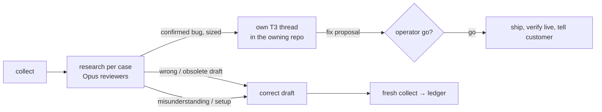

# Mailbox review (core)

Scope: every thread holding an unsent ReplyPen draft. ReplyPen's triage of undrafted mail is trusted;
the rest of the inbox is not rechecked. Gmail supplies drafts, public `rp` supplies per-thread run
evidence. A successful run is evidence, never proof the answer is right.

Needs authenticated `rp`, `uv`, and a [google-workspace-core](../google-workspace-core/SKILL.md) account
wrapper. **The project wrapper owns:** `--project`, Google mailbox UUID, GWS wrapper path, output dir,
grounding commands and repos, team/personas, whether draft corrections are on by default, how to tell
which operator runs it (developer vs product owner), where bug threads go. Never put those here.

1. `scripts/cockpit.py collect`; read **only `index.json`** first ([commands](references/commands.md):
   inputs, bounds, artifacts). It verifies mailbox UUID/provider/email against the GWS identity.
2. Leave answered, no-inbound and confident simple drafts alone. Pick uncertain or consequential ones,
   stale ones included; a draft without a run is low priority (stale/discard unless consequential).
   Health flags help prioritize; keywords or a green run never decide answer quality.
3. `detail` for every thread you will write a finding for. One **Opus, high effort, in-harness
   subagent** per customer (group that customer's threads) with [the reviewer recipe](references/reviewer.md)
   plus the wrapper's grounding brief. A Codex coordinator hands the set to a Claude worker; never
   silently substitute a model. Opus unavailable → report it, leave corrections pending.
4. **Research first.** Most "it's broken" mails are misunderstanding or setup: the draft answers them.
   A bug needs evidence (logs, rows, a live reproduction) and a count of affected customers. A
   confirmed bug, above all one hitting several customers, gets its own T3 thread (`t3_thread_launch`
   in the owning repo; second opinion inside it via `delegate_task`) that finds the fix; shipping per
   "Go deep" below. Explain at the operator's level (the wrapper says who is who).
5. Merge evidence-supported findings, `validate`, then `apply --allow-draft-corrections` for wrong or
   obsolete drafts **when the wrapper (or this request) authorizes corrections**. Render the page to
   the operator's artifact dir (normally `~/Downloads`): seven prioritized rows, rest collapsed;
   subject + one action; closed accordions for owner and technical evidence; brain proposals in their
   own section ([optional fields](references/optional-fields.md)). No raw mail or tokenized URLs.
6. End with a fresh `collect` and a ≤10-bullet ledger: send · decide · discard. Sending and deleting
   need the operator's explicit go in that conversation; verify in Gmail afterwards. A new reply where
   no draft is left: GWS `gmail-draft --reply-to-message <last id> --from "<Name> <mailbox>"` (without
   `--from` the display name is lost), HTML from `rp dev tools draft-render`, then send.

## Go deep, whoever runs it

- Developer or product owner at the keyboard, the agent debugs as far as this machine allows: product
  code, every project repo and doc on disk, the brain, read-only production data/logs/traces, a live
  reproduction. A draft that says "we're following up with our developers/engineering" is a research
  gap, not an answer: get to the bottom first (one `delegate_task` per deep case), then reply with the
  cause and a step the customer can take today. Only facts that stay unknowable go to the developer:
  one ticket of one-line questions, drafted reply attached.
- **Say what limited you.** A missing env var, credential, CLI, repo or access, or a query that timed
  out → `dx_gaps` on the finding (page section "What limited this review"), naming who can grant it
  (wrapper), so the operator asks for it and the next run goes deeper. Never settle silently for a
  shallower answer.
- **Shipping a found fix:** a PR with tests on the critical path. Product-owner operator → the PR stays
  open for the developer. Developer operator → merge and ship when confident, verify live. A data fix
  scoped to one customer (one account or backup, reversible, regression risk rated low by the agent)
  may run on the operator's explicit go through an audited action or the repo's documented write path,
  read back afterwards; anything broader is a PR.

Reviewers stay read-only: no `rp ask`, retry, process-thread, sending, deletion, labels, archive or
customer actions. A needed mutation becomes an audited action or its own thread. Draft correction
needs the current draft to be the untouched AI body (leading `[[✏️ …]]` notes and Gmail re-wrapping
tolerated, any word change refused), a unique draft, unchanged thread/run/message and independent
evidence; recipients, attachments and quotes are preserved, the original saved and read back. Gmail
cannot lock thread and draft together: a residual race exists, never call it race-free.

Schedule only when asked, with machine-local definitions. Never borrow a colleague's credentials.
