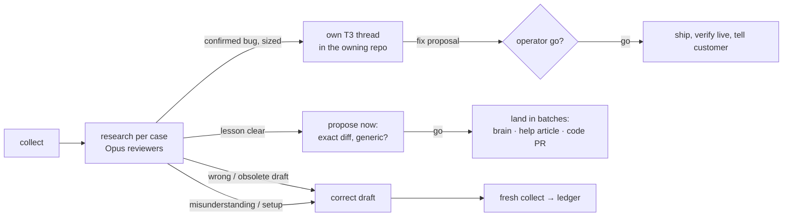

# Mailbox review (core)

North star: nothing that needs us slips through. Scope: every thread holding an unsent draft, plus
**follow-ups**: threads we (a person or ReplyPen, notes included) wrote in during the last 14 days whose
newest mail is an unanswered message from a person and that hold no draft (ReplyPen never ran, only
left a note, or declined). Older undrafted inbox mail stays ReplyPen's triage. A successful ReplyPen run
is evidence, never proof the answer is right.

**One source of truth per fact, no state files across runs:** Gmail holds mail and drafts, `rp` holds
ReplyPen's runs, T3 holds who handles what and what was decided (`Mail-ref` claims, case threads, each
day's 🧭 report and the operator's replies in it). A run's bundle directory is scratch for that run plus
the correction audits. One machine runs a mailbox at a time; an operator swap gets a handover note
(below).

Needs authenticated `rp`, `uv`, and a [google-workspace-core](../google-workspace-core/SKILL.md) account
wrapper. **The project wrapper owns:** `--project`, Google mailbox UUID, GWS wrapper path, output dir,
grounding commands and repos, team/personas, whether draft corrections are switched off, how to tell
which operator runs it (developer vs product owner), where bug threads go. Never put those here.

1. `scripts/cockpit.py collect`; read **only `index.json`** first ([commands](references/commands.md):
   inputs, bounds, artifacts). It verifies mailbox UUID/provider/email against the GWS identity and
   tags every thread with what T3 knows (`t3`: owner + newest mentioning threads, one `t3-mail-link
   index` pass) and `new_since_t3` (messages after T3 last mentioned it). Title the coordinating T3
   thread `🧭 <mailbox> review <date>`: it touches many cases, owns none.
2. **Continue from T3 before researching anew** ([continuity](references/continuity.md)): a thread T3
   already knows gets its earlier conclusion read from the owner, else the newest mentioning thread;
   `new_since_t3: 0` → carry it in one line, otherwise research only what is new. Read unsettled
   earlier 🧭 threads to their end (open promises without new mail live in their ledgers): the
   operator's replies there are evidence of decisions, never fresh authorization. Never duplicate
   running work; never message an old reviewer: seed a new one with what it concluded.
3. **This week's mail first.** The cockpit answers "what do I send, fix or decide today", not a backlog
   audit. `index.json` marks a thread `stale` when no person has written for 14 days (`customer_at`:
   our own mail, tool notifications, auto-replies and bounces don't count). A stale case gets no reviewer
   and no deep research: a short finding with one action (usually "discard the draft", or the open debt
   we owe: money, a promised document, an unanswered data-loss report) that the report folds into "old
   cases". Only new customer mail, or a dated promise of ours due within 7 days, brings it
   back to the top; a renewal date recurs and never counts. Among fresh threads, leave answered,
   no-inbound and confident simple drafts alone; pick uncertain or consequential ones. Health flags help
   prioritize; keywords or a green run never decide answer quality.
   Follow-ups (`scope: followup`, "reply waiting, no ReplyPen draft"): courtesy (thanks, ack,
   auto-reply) → no finding. Something owed (a question, a new problem, a promise of ours due) →
   a finding like any other; when the answer is clear, write the reply as a new draft (step 7 recipe,
   never send) and say why ReplyPen had none: no run is a host/ingestion question for `replypen`, a
   note-only or declined run a lesson ("Persist the lesson" below).
4. `detail` for every thread you will write a finding for. **Delegate generously, after routing**:
   step 3's age rule and continuity's routing (unchanged → carry, existing owner → its thread) run
   first; each remaining uncertain or consequential customer gets its own `delegate_task` (Claude Opus,
   high effort, async; a Codex coordinator does the same), at most `8` per run, most consequential
   first, the rest listed as deferred. Its brief file `<bundle>/briefs/<customer>.md` holds
   [the reviewer recipe](references/reviewer.md), the wrapper's grounding brief, that customer's detail
   paths, the T3 thread ids that already worked on it (read their conclusion, don't redo it) and the
   coordinator's objections. The reviewer's final answer in its T3 thread is the finding, with the
   case's `Mail-ref` line so tomorrow's index finds it. The coordinator orchestrates and verifies; it
   never researches ten cases serially. In-harness sub-agents only for quick single-fact checks. Never
   silently substitute a model. Opus unavailable → report it, leave corrections pending. As each
   reviewer returns, propose its lessons right away ("Persist the lesson" below), not at the end.
5. **Research first.** Most "it's broken" mails are misunderstanding or setup: the draft answers them.
   A bug needs evidence (logs, rows, a live reproduction) and a count of affected customers. A
   confirmed bug, above all one hitting several customers, gets its own T3 thread (`t3_thread_launch`
   in the owning repo, its brief carrying the case's `Mail-ref` line; second opinion inside it via
   `delegate_task`) that finds the fix; shipping per
   "Go deep" below. Explain at the operator's level (the wrapper says who is who).
6. **Correct drafts** wherever you have a **better version** of an untouched ReplyPen draft (wrong,
   obsolete, incomplete, or just clearer): `apply --thread-id … --draft-id … --run-id … --fingerprint
   <detail fingerprint> --body-file … --reason … --allow-draft-corrections`; no operator go needed,
   unless the wrapper switches corrections off. A claim that depends on a human step (pay, refund,
   setting) gets a leading `[[✏️ Before sending: …]]` note in the draft. A missing reply (follow-up):
   GWS `gmail-draft --reply-to-message <last id> --from "<Name> <mailbox>"` (without `--from` the
   display name is lost), HTML from `rp dev tools draft-render`; never send.
7. **Report = your final T3 reply**, written from [the template](references/report.md): up to seven
   cards for what needs the operator today, the rest one line each, old cases folded, then bugs,
   limits, lessons, the coverage line verbatim, and a ≤10-bullet ledger: send · decide · discard.
   Subjects only through each row's `link`, other URLs only through `cockpit.py link`; no raw mail.
   Sending and deleting need the operator's explicit go in that conversation; verify in Gmail after.

## Go deep, whoever runs it

- Developer or product owner at the keyboard, the agent debugs as far as this machine allows: product
  code, every project repo and doc on disk, the brain, read-only production data/logs/traces, a live
  reproduction. A draft that says "we're following up with our developers/engineering" is a research
  gap, not an answer: get to the bottom first (one `delegate_task` per deep case), then reply with the
  cause and a step the customer can take today. Only facts that stay unknowable go to the developer:
  one ticket of one-line questions, drafted reply attached.
- **Say what limited you.** A missing env var, credential, CLI, repo or access, or a query that timed
  out → a line under "What limited this review" in the report, naming who can grant it
  (wrapper), so the operator asks for it and the next run goes deeper. Never settle silently for a
  shallower answer.
- **Escalate only what research cannot settle** (rare; each names the exact question):
  1. *Decisions, not facts:* money (refund, discount, void), contract or legal commitments, commercial
     offers, a policy change customers will see.
  2. *Writes beyond a scoped one-customer fix:* infra, bulk data, irreversible deletion, deploys, publishing.
  3. *Facts outside every system this machine reaches:* a call or chat nobody logged, an admin console
     without access (then also a "What limited this review" line), a vendor's private state, why code was deliberately
     disabled when git history does not say.
  4. *Human hands:* login, phone, eID, payment, signature; sending or deleting mail.
  Missing access is a "What limited this review" line, not a reason to stop: answer with what is reachable and say what
  the rest needs.
- **Shipping a found fix:** a PR with tests on the critical path and an opposite-model review, whoever
  operates. A product owner at the keyboard runs agents strong enough to find and fix the root cause:
  low-hanging fruit (clear cause, contained change, tests green) gets fixed, tested and landed per the
  repo's rules in that run, not parked for the developer. Escalate to the developer only when the
  agent sees no clear path forward (cause unclear, change broad or risky, infra/migration/security),
  with the evidence and the exact question. Deploys follow the repo's rules; verify live. A data fix
  scoped to one customer (one account or backup, reversible, regression risk rated low by the agent)
  may run on the operator's explicit go through an audited action or the repo's documented write path,
  read back afterwards; anything broader is a PR.
- **Local actions for one-offs, ReplyPen actions for the routine.** A write that is rare or ad hoc
  (a billing switch, a vendor API call, a one-customer fix) runs from the developer machine, not as a
  new ReplyPen action: a small script in the wrapper's local-actions dir, reading the credential at
  runtime from the store the wrapper names (never printed, copied or committed), dry-run by default
  (exact planned calls + before-state), `--execute` with an idempotency key, read back, and a private
  audit record (go, before/after, request ids). Example: switching a subscription to yearly
  pay-by-invoice through the payment provider's API with the app's own key. Only what recurs becomes
  a ReplyPen action. The operator's explicit go still gates every write; the wrapper says which
  credentials and writes are in bounds.

## Persist the lesson per case: you are ReplyPen's teacher

Solving today's case by hand is half the job. The other half: next time ReplyPen's own draft gets it
right without a coding agent. Do it **per case, while you answer**: at the end it is forgotten.
- **Spot it.** For every draft you corrected or had to deepen, ask what ReplyPen lacked: a fact or
  policy, a case runbook, routing (the symptom table pointed elsewhere), grounding (a script hid the
  deciding fact), an action (the fix needed hands), a wrong or missing help article, a product gap (a
  screen or error that caused the mail). If the brain already said the right thing, it is a model/host
  issue for `replypen`, not a brain edit.
- **Propose as soon as it is clear,** to the operator, before the next case (a question tool where the
  harness has one; keep researching while it waits). Concrete: file + section (article id or slug,
  repo path) + the text to add or replace as a short diff or quote block, never "improve the brain".
  Target where the fact lives: the brain (policy, runbook, routing, script, action); a help article
  (customers and ReplyPen's KB both read it: fix it there, not in the brain); product code. Ask two
  things: green light? Truly a generic rule (name the class of cases; never this customer) or a one-off
  that stays out?
- **Land on the green light, in batches.** Each lesson's status (proposed / go / landed) sits in the
  report's lessons section; the next run reads it there.
  - *Brain:* one brain thread per run (`t3_thread_launch` in the brain checkout the wrapper names),
    started at the first go, fed later batches by `t3_thread_send`, keyed to the run ids it fixes. It
    reads the brain's `AGENTS.md` and repo-local brain-dev skills (`<brain>/.agents/skills/`, copies
    of `replypen-brain-skills`; `local-brain-work` first), writes the approved rule, proves it on the
    real case through `brain-simulate`/`brain-ask` against a `dev/*` ref (simulation only, never a
    rerun of the customer thread): before wrong, after right. Then `brain-publish`. The go on that
    exact text is the publish go; a failed proof or a materially different text returns to the
    operator with the simulated before/after.
  - *Help article:* the wrapper's edit and publish path, then sync ReplyPen's KB and verify live.
  - *Product code:* its own `t3_thread_launch` in the owning repo, a PR per "Go deep" shipping.
- **Fix facts at their source.** A product fact the brain reads from a mirrored repo (wrapper lists the
  mirrors) is fixed in that repo's docs, not copied into the brain.

Reviewers stay read-only: no `rp ask`, retry, process-thread, sending, deletion, labels, archive or
customer actions. A needed mutation becomes an audited action or its own thread. Draft correction
needs the current draft to be the untouched AI body (leading `[[✏️ …]]` notes and Gmail re-wrapping
tolerated, any word change refused), a unique draft, unchanged thread/run/message and independent
evidence; recipients, attachments and quotes are preserved, the original saved and read back. Gmail
cannot lock thread and draft together: a residual race exists, never call it race-free.

Schedule only when asked: a repo job one machine opts into, one fresh 🧭 thread per workday
([schedule](references/schedule.md)).

**Operator swap** (PJ covers a week, then Willem again): on request, write one concise handover note
to `~/Downloads/<prefix>-handover-<date>.md` and hand it over; never commit it. ≤1 page: open cases
(Gmail link, state, next step, owning T3 thread), pending decisions and gos, lessons in flight,
anything due this week. The receiving machine's agent reads it as context; T3 history stays local.
Never borrow a colleague's credentials.
