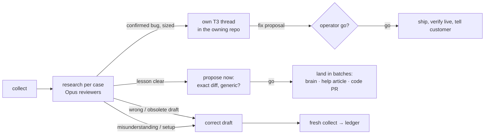

# Mailbox review (core)

North star: nothing that needs us slips through. Scope: every thread holding an unsent draft, plus
**follow-ups**: threads we or ReplyPen touched in the last 14 days (our reply, or a run that left
only a note or declined) whose newest mail is an unanswered message from a person, with no draft.
Older undrafted inbox mail stays ReplyPen's triage. A green ReplyPen run is evidence, never proof.

**T3 is the memory; no state files across runs.** Gmail holds mail and drafts, `rp` the runs, T3 who
handles what and what was decided (`Mail-ref` claims, case threads, each day's 🧭 report and the
operator's replies). A run's bundle directory is that run's scratch plus correction audits. One
machine runs a mailbox at a time.

Needs authenticated `rp`, `uv`, and a [google-workspace-core](../google-workspace-core/SKILL.md) account
wrapper. **The project wrapper owns** (never here): `--project`, Google mailbox UUID, GWS wrapper
path, output dir, grounding commands and repos, team/personas, whether draft corrections are off,
which operator runs it (developer vs product owner), where bug threads go.

1. **Collect:** `scripts/cockpit.py collect`, then read **only `index.json`** ([commands](references/commands.md)).
   Title the coordinating thread `🧭 <mailbox> review <date>`: it touches many cases, owns none.
2. **Continue from T3 before researching anew** ([continuity](references/continuity.md)): each row's
   `t3` and `new_since_t3` route it (carry, wake its owner, or seed a new reviewer); read unsettled
   earlier 🧭 threads to their end. The operator's replies there are evidence, never fresh
   authorization.
3. **This week's mail first:** "what do I send, fix or decide today", not a backlog audit.
   - `stale` (no person wrote for 14 days; our mail, tool notifications, auto-replies, bounces don't
     count): no reviewer, one short action under "old cases" (usually discard the draft, or the debt
     we owe: money, a promised document, an unanswered data-loss report). Only new customer mail or a
     promise of ours due within 7 days brings it back; a recurring renewal date never counts.
   - Fresh: leave answered, no-inbound and confident simple drafts alone; pick the uncertain or
     consequential. Health flags prioritize; keywords or a green run never decide quality.
   - Follow-ups (`scope: followup`): courtesy (thanks, ack, auto-reply) → nothing. Something owed (a
     question, a new problem, a promise due) → a finding, a new draft (step 6) and why ReplyPen had
     none: no run → host/ingestion question for `replypen`; note-only or declined run → a lesson.
4. **Delegate generously, after routing.** `detail` every thread you will write a finding for. Each
   remaining uncertain or consequential customer gets its own `delegate_task` (Claude Opus, high,
   async, also from a Codex coordinator), at most `8` per run, most consequential first, the rest
   listed as deferred. Brief `<bundle>/briefs/<customer>.md`: [reviewer recipe](references/reviewer.md),
   the wrapper's grounding brief, detail paths, T3 thread ids that already worked on it, your
   objections. Its final T3 answer is the finding, with the `Mail-ref` line. The coordinator
   orchestrates and verifies, never researches cases serially; in-harness sub-agents only for
   single-fact checks. Never silently substitute a model: Opus unavailable → report it, leave
   corrections pending. Propose each reviewer's lessons as it returns ("Persist the lesson").
5. **Research first.** Most "it's broken" mails are misunderstanding or setup: the draft answers them.
   A bug needs evidence (logs, rows, a live reproduction) and a count of affected customers; then its
   own `t3_thread_launch` in the owning repo (brief carries the `Mail-ref` line; second opinion
   inside it via `delegate_task`), shipped per "Go deep". Explain at the [operator's level](references/report.md#operator-level).
6. **Correct drafts** wherever you have a **better version** of an untouched ReplyPen draft (wrong,
   obsolete, incomplete, or just clearer): `cockpit.py apply … --allow-draft-corrections`, no operator
   go unless the wrapper switches corrections off. A claim that depends on a human step (pay, refund,
   setting) gets a leading `[[✏️ Before sending: …]]` note. Missing reply (follow-up): GWS
   `gmail-draft --reply-to-message <last id> --from "<Name> <mailbox>"` (without `--from` the display
   name is lost), HTML from `rp dev tools draft-render`; never send.
7. **Report = your final T3 reply** ([template](references/report.md)). Sending and deleting need the
   operator's explicit go in that conversation; verify in Gmail after.

## Go deep, whoever runs it

Debug as far as this machine allows, say what limited you, escalate only what research cannot
settle. Owner of depth, the escalation list, **Shipping a found fix** and **Local actions** (one-off
writes as audited dry-run-first scripts): [go-deep](references/go-deep.md).

## Persist the lesson per case: you are ReplyPen's teacher

Half the job: next time ReplyPen's own draft gets it right without a coding agent. Do it **per case,
while you answer**: at the end it is forgotten.
- **Spot it.** For every draft you corrected or deepened: what did ReplyPen lack? A fact or policy, a
  case runbook, routing, grounding (a script hid the deciding fact), an action, a wrong or missing
  help article, a product gap. The brain already said it right → model/host issue for `replypen`.
- **Propose as soon as it is clear,** before the next case (a question tool where the harness has one;
  keep researching while it waits): file + section (article id/slug, repo path) + the exact text as a
  short diff, never "improve the brain". Target where the fact lives: brain (policy, runbook, routing,
  script, action), help article (customers and ReplyPen's KB both read it), product code. Ask: green
  light? Truly generic (name the class of cases, never this customer) or a one-off that stays out?
- **Land on the green light, in batches:** [lessons](references/lessons.md) (brain proof and publish,
  help article, code PR).

## Hard limits

- Reviewers stay read-only ([recipe](references/reviewer.md)); a needed mutation becomes an audited
  action or its own thread.
- `apply` overwrites only an untouched AI body of a unique draft on an unchanged thread and run,
  backed by independent evidence; keeps recipients, attachments and quotes, saves the original,
  reads back ([commands](references/commands.md)). Gmail cannot lock thread and draft together: a
  residual race exists, never call it race-free.

Schedule only when asked ([schedule](references/schedule.md)). **Operator swap** (one operator
covers a week, then hands back): on request, one handover note at
`~/Downloads/<prefix>-handover-<date>.md`, never committed, ≤1 page: open cases (Gmail link, state,
next step, owning T3 thread), pending decisions and gos, lessons in flight, anything due this week.
T3 history stays local; never borrow a colleague's credentials.
