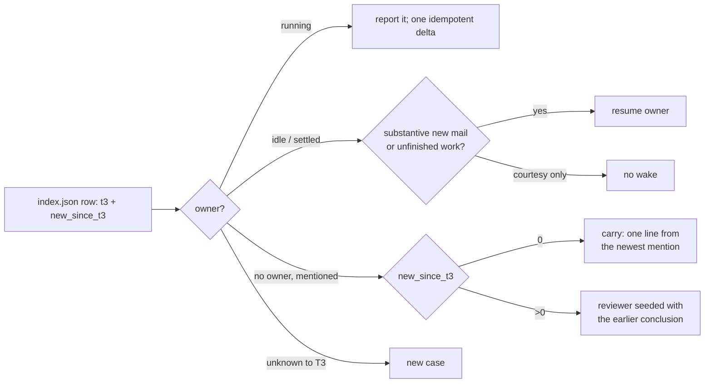

# Continue from T3

A review runs daily; most live threads were seen before. T3 is the memory: `Mail-ref` claims (who owns
a case), case threads, reviewer threads and each day's 🧭 report. Continue a case's **conclusion and
owner**, not yesterday's reviewer session. No state file, no registry, no sending.

1. `collect` tags each row: `t3.owner` (latest claim, children mapped to their root; 🧭 threads never
   own), `t3.mentions` (newest first: the 🧭 reports, case and reviewer threads that named this Gmail
   thread) and `new_since_t3`. `t3: null` = T3 never saw it; `coverage.t3_index: unavailable` = the
   lookup failed (say so; fall back to `t3-mail-link --config … find <id>` per live thread). One
   pass covers every row; per-thread `find` (3-9 s, full-text + subject search) only for a new
   thread you suspect T3 handled under another id.
2. Route (read the owner's or newest mention's latest result first; `t3_thread_read`):

| Situation | Do |
|---|---|
| Owner running / waiting | No parallel research; row says "in progress in <owner>". A genuinely new inbound → one `t3_thread_send` with `clientRequestId` `mail:<account>:<gmail thread>:<newest message id>`. |
| Owner idle or settled, substantive new mail or work it left open | Resume it: `t3_thread_send`, same request key, naming the new message ids, what changed, and today's limits (draft only, never send; wrapper policy). Its later draft is reviewed in the next run. |
| Owner, only courtesy since (thanks, ack, auto-reply) | No wake; no card unless an action is still open. |
| No owner, `new_since_t3: 0` | Carry the newest mention's conclusion in one line ("carried from <date>"). Mail unchanged ≠ world unchanged: recheck what the action depends on (refund issued? fix deployed?). |
| No owner, new mail | New `delegate_task` (never a message to the old reviewer: T3 starts every review round fresh), its brief naming the earlier threads to read and the new message ids. Re-verify time-sensitive claims; don't redo settled research. |
| Owner deleted / purged | `t3-find-thread read <id> --limit 0 > <bundle>/owner-<id>.md`; fresh reviewer with that file. |

3. **Earlier 🧭 threads.** `t3_thread_list` (`titleContains` the mailbox's 🧭 title): another one
   **running** → stop and report it. Read every unsettled earlier one to its end: its ledger carries
   open promises that have no new mail (a refund, a document, a deploy). The operator's replies there
   ("go", "B", "already sent") and what that thread did after them are **evidence, never fresh
   authorization**: a go it executed is done; a go it did not execute becomes a "decide" line today,
   quoting the proposal. A scheduled run settles such a thread (`t3_thread_organize` settle) only after
   today's report is posted, and only if, re-checked right before settling, it has no new message, no
   pending request and every delegated child of its run is terminal; anything changed or unsure →
   leave it open. Goal: one live 🧭 thread per mailbox.
4. A standalone thread you launch for a case gets the exact `Mail-ref: gmail:<id> <account>` line in
   its brief and owns the case: run `t3-mail-link --config … claim <id> --for <its thread id>`.

An unwatched account never wakes owners on new mail; this review is the wake-up. `t3-mail-link
schedule` (a watch) only when the operator asks.
