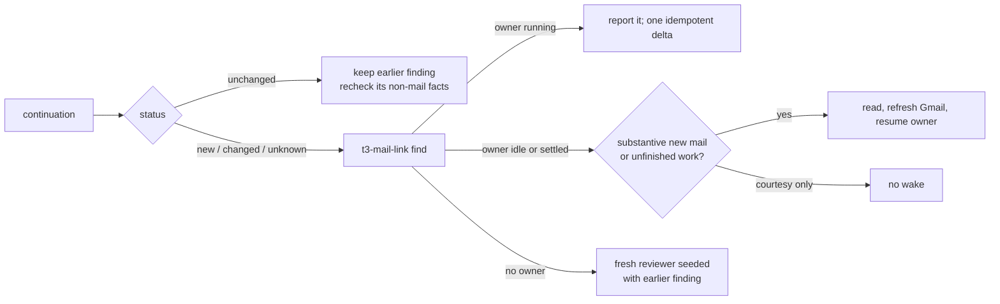

# Continue earlier cases

A review runs daily; most of its threads were seen before. Continue the case's **evidence and owner**,
not yesterday's reviewer session. State lives where it already is: earlier bundles (findings + Gmail
snapshots) and T3 history (`Mail-ref` claims, thread text). No registry, no mailbox watch, no sending.

1. `cockpit.py continuation --bundle <today> --history <earlier --out dirs>` (glob fine; the wrapper
   names them). Only bundles of the same account + project + mailbox UUID count (`incompatible_bundles`
   says how many were skipped). Per thread in `continuation.json`: `status` new / unchanged / changed /
   unknown, `changes` (inbound, sent, drafts, removed, run), `new_inbound` previews, the `prior`
   finding (bundle, date, verdict, action) and its `mail_ref`. Earlier cases outside today's index
   join it (`carried`) when they still hold a draft, got new inbound, or lack an old snapshot; the
   rest are listed with `in_index: false`. Missing evidence or a failed fetch is `unknown` (and
   counted uncovered), never `unchanged`.
2. Every thread you will look at (new, changed, unknown):
   `t3-mail-link --config <gws wrapper> find <thread id> --exclude <own T3 id> --json`.
   - `owners[].evidence == "owner"`: the case owner (watched case, else the latest claim T3 recorded:
     a `gmail-draft`/`-send`/`-update` or `claim` by that thread, children mapped to their root,
     routing threads ignored, releases honored). `marker` / `id` / `topic`: candidates to read, not
     owners.
   - `history`: reviewer children of an earlier run (parent = that day's 🧭 coordinator). Read their
     result as evidence; never `t3_thread_send` to them.
3. Route (always `t3_thread_read` the owner's latest result and re-fetch the Gmail thread first):

| Situation | Do |
|---|---|
| Owner running / waiting | No parallel research; row says "in progress in <owner>". A genuinely new inbound → one `t3_thread_send` with `clientRequestId` `mail:<account>:<gmail thread>:<newest message id>`. |
| Owner idle or settled, substantive new mail or work it left open | Resume it: `t3_thread_send`, same request key, naming the new message ids, what changed, and today's limits (draft only, never send; wrapper policy). Its later draft is reviewed in the next run. |
| Owner, only courtesy since (thanks, ack, auto-reply) | No wake; no finding unless an action is still open. Settled is resumable, not unfinished. |
| Owner deleted / purged | `t3-find-thread read <id> --limit 0 > <bundle>/owner-<id>.md`; fresh reviewer with that file. A replacement standalone thread only when the case needs one (step 5 rules). |
| No owner, earlier finding | Fresh reviewer (new sub-agent / `delegate_task`, never a resumed child) given the prior finding path, `new_inbound` and `changes`. Re-verify time-sensitive claims (payments, deploys, deadlines); don't redo settled research. |
| Unchanged | No reviewer. Mail unchanged ≠ world unchanged: recheck what the earlier action depends on (refund issued? fix deployed?). Carry the finding with today's `detail` fingerprint and say "carried from <date>" in `changed_since_run`. |

4. A standalone thread you launch for a case gets the exact `Mail-ref: gmail:<id> <account>` line in
   its brief and owns the case: run `t3-mail-link --config … claim <id> --for <its thread id>` (the
   explicit `owner=` wins over the 🧭 coordinator, which never owns). Put its link in the finding's
   `case_thread`; the page prints it beside the Mail-ref line.
5. Concurrency: one coordinator per mailbox. Before routing, `t3_thread_list` for another running
   `🧭 … review` of the same mailbox → stop and report it. Different mailboxes are independent. The
   request key makes a repeated resume a no-op; an accepted-but-unconfirmed send → read the owner
   before retrying.

An unwatched account never wakes owners on new mail; this review is the wake-up. `t3-mail-link
schedule` (a watch) only when the operator asks.
