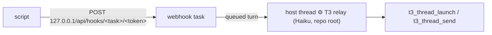

# t3-relay: start or message a thread from a script outside T3

For launchd jobs and pollers (t3-schedule, recording-watcher, t3-mail-link, warm-ups). Agents
inside T3 call the MCP tools directly and never need this.

```bash
t3-relay launch --project /abs/repo --title "⏰ Daily digest" --model opus -- "Read and execute /abs/brief.md"
t3-relay send --thread <threadId> [--mode queue] -- "New mail in the linked thread: …"
t3-relay check
```

`--model` takes an alias or id; account and house effort come from `t3-pick-instance` (capacity
routing). `--instance` / `--effort` override. Without `--model`: opus, else sol (never the relay's
own Haiku, which an unset `modelSelection` would inherit). haiku/luna refused unless
`--allow-small-model` (see [SKILL.md](SKILL.md#model-tier)).
Exit 0 = accepted (HTTP 202). Delivery is async (~15–20 s), with no thread id back. Keep the
caller's own dedupe state, and don't retry an accepted request.

## How it works



One native scheduled task titled `⚙️ T3 relay` (webhook trigger), **bound to one host thread**:
each request becomes a queued turn there, rendering `{{body.instruction}}`: one exact MCP call,
built by the script. The host settles after each turn; the next request wakes it.
Why bound: T3 gives an unbound task (fresh thread per run) a new git worktree from `origin/main`
per run (`scheduledTaskWorkspaceStrategy`, not configurable), so every relay did a fetch and
left a worktree; a fetch timeout or `git config` lock race dropped the request after the script
already got 202. A bound task runs in the repo root.

The only internal T3 details used are the loopback route `/api/hooks/<taskId>/<token>` and
read-only lookups in `statev2.sqlite` (token, host binding). Both live in `scripts/t3-relay`,
which checks the schema and fails loudly. It never prints the token. No T3 Connect needed.
`t3-relay check` fails on an unbound relay or a deleted host thread.

## One-time setup (per machine)

From any T3 thread in a repo you keep (e.g. your setup repo), call `t3_thread_launch` with
`title: "⚙️ T3 relay"`, `workspaceStrategy: {"type":"root"}`, `modelSelection` = the Haiku from
`t3-pick-instance haiku` (effort `low`), and a `message` telling it to call `schedule_task` once
(it inherits the host's model, account and project):

- `title`: `⚙️ T3 relay` · `schedule`: `{"type":"webhook"}` · `bindToCurrentThread`: `true`
- `prompt` (verbatim, keep the double braces):

```text
T3 relay request {{body.id}}, sent by a local script on this Mac (not by the user). You are a mechanical bridge: do exactly the action below with the T3 MCP tools, nothing else, no commentary, no file edits.

{{body.instruction}}

Then reply with one line: "relay {{body.id}}: ok <ids returned>" or "relay {{body.id}}: FAILED <error>". As your very last tool call, settle this thread: t3_thread_organize {"action":"settle"} without threadId.
```

Verify with `t3-relay check`. Never delete or purge the host thread (`check` flags it).

## Heal (relay created before 2026-10-19, unbound)

Symptom: `t3-relay check` says "not bound", relay threads fail with "Workspace preparation
failed … fetchRemote / configureBaseRef", worktrees pile up under `~/.t3/worktrees/<repo>`.
Launch the host thread as above, but its `message` calls `update_scheduled_task` with
`{"scheduledTaskId": "<id from list_scheduled_tasks>", "bindToCurrentThread": true}` (keeps
task id, token and prompt; switches the workspace to root). Then `t3-relay check`, and remove
the old relay worktrees: clean, with no commits outside the remotes, branch `t3/*`.
