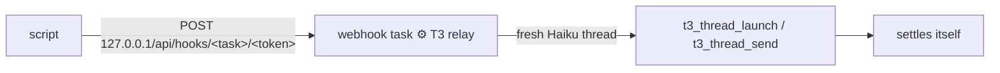

# t3-relay: start or message a thread from a script outside T3

For launchd jobs and pollers (t3-schedule, recording-watcher, t3-mail-link, warm-ups). Agents
inside T3 call the MCP tools directly and never need this.

```bash
t3-relay launch --project /abs/repo --title "⏰ Daily digest" --model opus -- "Read and execute /abs/brief.md"
t3-relay send --thread <threadId> [--mode queue] -- "New mail in the linked thread: …"
t3-relay check
```

`--model` takes an alias or id; account and house effort come from `t3-pick-instance` (capacity
routing). `--instance` / `--effort` override. Without `--model`: opus, else sol (never the relay's
own Haiku, which an unset `modelSelection` would inherit). haiku/luna refused unless
`--allow-small-model` (see [SKILL.md](SKILL.md#model-tier)).
Exit 0 = accepted (HTTP 202). Delivery is async (~15–20 s), with no thread id back. Keep the
caller's own dedupe state, and don't retry an accepted request.

## How it works



One native scheduled task titled `⚙️ T3 relay` (webhook trigger, fresh thread per request, Haiku).
Each request renders `{{body.instruction}}`: one exact MCP call, built by the script. The relay
thread then settles itself. The only internal T3 details used are the loopback route
`/api/hooks/<taskId>/<token>` and a read-only token lookup in `statev2.sqlite`. Both live in
`scripts/t3-relay`, which checks the schema and fails loudly. It never prints the token. No T3
Connect needed.

## One-time setup (per machine)

Ask any T3 agent: "create the T3 relay per t3-manage-thread relay.md". The agent runs a
`delegate_task` (target `$(t3-pick-instance haiku)`, `mode: "wait"`). Its child calls
`schedule_task` once, so the task inherits Haiku and that account:

- `title`: `⚙️ T3 relay` · `schedule`: `{"type":"webhook"}` · `bindToCurrentThread`: `false`
- `prompt` (verbatim, keep the double braces):

```text
T3 relay request {{body.id}}, sent by a local script on this Mac (not by the user). You are a mechanical bridge: do exactly the action below with the T3 MCP tools, nothing else, no commentary, no file edits.

{{body.instruction}}

Then reply with one line: "relay {{body.id}}: ok <ids returned>" or "relay {{body.id}}: FAILED <error>". As your very last tool call, settle this thread: t3_thread_organize {"action":"settle"} without threadId.
```

Verify with `t3-relay check`. The relay runs in the creating thread's project. Each run is a
settled thread named `⚙️ T3 relay`; `t3-purge-threads` cleans them up.
