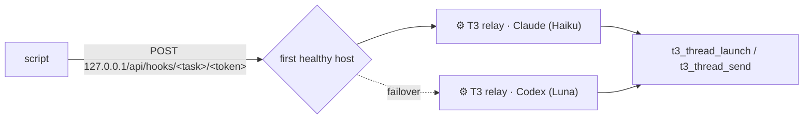

# t3-relay: start or message a thread from a script outside T3

For launchd jobs and pollers (t3-schedule, recording-watcher, t3-mail-link, warm-ups). Agents
inside T3 call the MCP tools directly and never need this.

```bash
t3-relay launch --project /abs/repo --title "⏰ Daily digest" --model opus [--wait 120] -- "Read and execute /abs/brief.md"
t3-relay send --thread <threadId> [--mode queue] [--wait 120] -- "New mail in the linked thread: …"
t3-relay status <rid> [--wait 60]   # ok <threadId> | failed <why> | pending <where>
t3-relay check                      # every host + its health
```

`--model` takes an alias or id; account and house effort come from `t3-pick-instance` (capacity
routing). `--instance` / `--effort` override. Without `--model`: opus, else sol (never the relay
host's model, which an unset `modelSelection` would inherit). haiku/luna refused unless
`--allow-small-model` (see [SKILL.md](SKILL.md#model-tier)).

Exit 0 = accepted (HTTP 202, async, prints `accepted: relay <rid> via <host>`). With `--wait`:
0 = the effect exists (thread with that title launched since the request / message with
`clientRequestId relay-<rid>` landed), 1 = failed (the host turn carrying the request ended
without the effect, so a retry cannot duplicate), 3 = still pending (don't retry; ask `status`
later). The effect decides, not the host's reply wording. Records: `~/.t3/userdata/t3-relay/`
(7 days).

## How it works



Each host = one native scheduled task titled `⚙️ T3 relay` (webhook trigger) **bound to its own
host thread** at the repo root, pinned to one account. A request becomes a queued turn there
rendering `{{body.instruction}}` (one exact MCP call); the host settles, the next request wakes it.
`t3-relay` posts to the oldest host that is not deleted, not stuck (open run > 5 min: limited or
hung), not failed in the last hour, and whose account passes `profile_routing.py --check`.
Two hosts on different providers survive one account's limit.

- **Why bound**: T3 gives an unbound task (fresh thread per run) a new git worktree from
  `origin/main` per run (`scheduledTaskWorkspaceStrategy`, not configurable): a fetch per request,
  worktree litter, and timeouts that dropped requests after the 202.
- **Why a small model at low effort**: the turn copies literal JSON into one MCP call. 73/73
  delivered requests were correct; every failure was infrastructure (worktree, session limit).
  Bigger models or effort add latency and quota, not reliability; failover covers availability.
- **Internal T3 details** (only in `scripts/t3-relay`, schema-checked, token never printed): the
  loopback route `/api/hooks/<taskId>/<token>` and read-only `statev2.sqlite` lookups (tasks,
  host runs, messages, deliveries). No T3 Connect needed.

## One-time setup (per machine): one host per provider

From any T3 thread in a repo you keep (e.g. your setup repo), per provider you have, call
`t3_thread_launch` with `title: "⚙️ T3 relay · Claude"` (or `· Codex`), `workspaceStrategy:
{"type":"root"}`, `runtimeMode: "full-access"`, `modelSelection` = the instance from
`t3-pick-instance haiku` (or `luna`) with effort `low` (`effort` for Claude, `reasoningEffort` for
Codex), and a `message` asking it to call `schedule_task` once (the task inherits the host's
model, account and project) with:

- `title`: `⚙️ T3 relay` · `schedule`: `{"type":"webhook"}` · `bindToCurrentThread`: `true`
- `prompt` (verbatim, keep the double braces):

```text
T3 relay request {{body.id}}, sent by a local script on this Mac (not by the user). You are a mechanical bridge: do exactly the action below with the T3 MCP tools, nothing else, no commentary, no file edits.

{{body.instruction}}

Then reply with one line: "relay {{body.id}}: ok <ids returned>" or "relay {{body.id}}: FAILED <error>". As your very last tool call, settle this thread: t3_thread_organize {"action":"settle"} without threadId.
```

Pick accounts with a large plan: a host is pinned, and `update_scheduled_task` cannot change its
model. To move a host: create the new one, then `delete_scheduled_task` the old task. Verify:
`t3-relay check`, then one probe per host: `t3-relay launch --via <instance> --model haiku
--allow-small-model --wait 120 --title "relay probe" -- 'Reply "ok", then settle this thread.'`.
Never delete or purge a host thread (`check` flags it).

## Heal (relay created before 2026-10-19)

Symptom: `t3-relay check` says "not bound" or reports one host, relay threads fail with
"Workspace preparation failed … fetchRemote / configureBaseRef", worktrees pile up under
`~/.t3/worktrees/<repo>`. Set up the hosts as above, probe them, `delete_scheduled_task` the old
unbound task, then remove the old relay worktrees: clean, with no commits outside the remotes.
