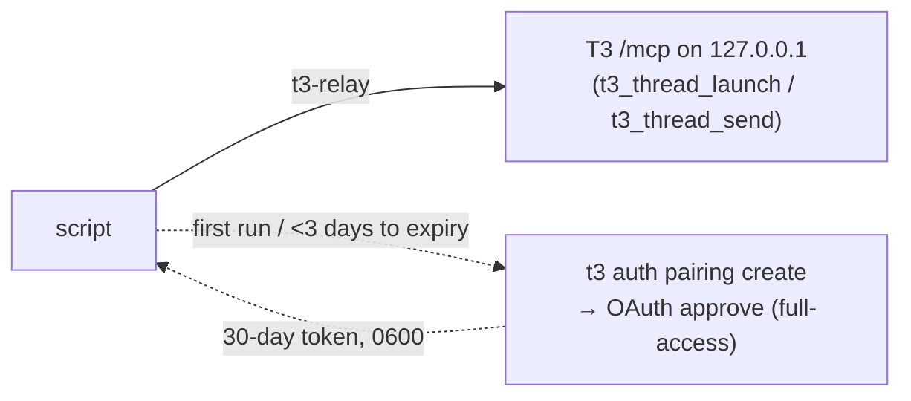

# t3-relay: start or message a thread from a script outside T3

For launchd jobs and pollers (t3-schedule, recording-watcher, t3-mail-link, warm-ups). Agents
inside T3 call the MCP tools directly and never need this, not even to get past a
`runtime_mode_escalation_denied` ([permission-ceiling.md](permission-ceiling.md)).

T3 ≥ 0.1.2 also ships `t3 thread start|send|show|list` (the app's CLI, `~/.t3/bin/t3`): fine for a quick
manual thread, but it takes no model options (T3 defaults: Opus effort medium, Sol low) and no retry key,
so scripts keep `t3-relay` for capacity routing, house effort and confirmed delivery.

```bash
t3-relay launch --project /abs/repo --title "⏰ Daily digest" --model opus [--wait 120] -- "Read and execute /abs/brief.md"
t3-relay send --thread <threadId> [--mode queue] [--wait 120] -- "New mail in the linked thread: …"
t3-relay status <rid> [--wait 60]   # ok <threadId> | failed <why> | pending <why>
t3-relay check                      # T3 reachable, MCP client approved, legacy relay hosts listed
```

`--model` takes an alias or id; account and house effort come from `t3-pick-instance` (capacity
routing). Provider aliases `--model openai|codex` select Astra, `claude|anthropic` select Opus.
Without `--model`: the named `--instance`'s provider default, otherwise opus, else astra. Unknown
provider → require `--model`. An explicit model wins, including Sol; `--instance` constrains
Claude/Codex capacity routing (other providers keep the named account), and `--effort` overrides
house effort. No automatic Astra-to-Sol fallback. haiku/luna refused unless
`--allow-small-model` (see [SKILL.md](SKILL.md#model-tier)). Launches run in the user's new-thread
permission default (`defaultRuntimeMode`, e.g. Auto; unset → `full-access`) at the project root (`workspaceStrategy: root`).

Output contract (callers parse it): exit 0 prints `accepted: relay <rid> via mcp (<threadId>)`,
and the thread / message already exists (`--wait` adds `ok <threadId>`). Exit 1 = T3 refused or
was unreachable, nothing ran, retry is safe. Exit 2 = usage. Rare lost answer (timeout after
sending): still `accepted`, `status` then decides by the effect (thread with that title since the
request / message `clientRequestId relay-<rid>`); absent after 10 min = `failed`. With `--wait`
that case exits 3 while unresolved: don't retry. Records: `~/.t3/userdata/t3-relay/` (7 days).

## How it works



`t3-relay` is an approved MCP client of T3 itself (`client:<session>` namespace), calling the
same tools agents use: deterministic, no model, no host thread. The token comes from T3's MCP
OAuth (PKCE), approved with a one-time pairing code that the local CLI mints (`~/.t3/bin/t3`, the
desktop app's own CLI; a global `t3` can lag the app). Cached in
`~/.t3/userdata/t3-relay/mcp-client.secret`, renewed when 3 days remain or on 401. Needs T3 ≥ 0.1;
nothing to set up.

- **Why not the old webhook host** (2026-10-19 → 21): T3 0.1.1 ([#20447](https://github.com/pingdotgg/t3code/pull/20447))
  frames every webhook `{{placeholder}}` as untrusted `<webhook-data-…>` data, signed or not, so a
  model bridge rightly refuses instructions from it. That framing is a safety layer: don't word
  around it.
- **Why not `t3 auth session issue`**: its sessions have no runtime ceiling, so MCP treats them as
  `approval-required` and refuses `full-access` launches. The OAuth approval sets the ceiling.
- **Internal T3 details** (only in `scripts/t3-relay`, token never printed): OAuth routes
  `/oauth/mcp/{register,decision,token}`, `/mcp`, and read-only `statev2.sqlite` lookups for
  `status` after a lost answer.

## Migrate from webhook relay hosts (before 2026-10-21)

`t3-relay check` lists enabled `⚙️ T3 relay` webhook tasks as obsolete. From a T3 thread:
`delete_scheduled_task` each, then settle its host thread. Probe: `t3-relay launch --model haiku
--allow-small-model --effort low --settle-when-done --wait 60 --project <repo> --title "relay
probe" -- 'Reply "ok".'`.
