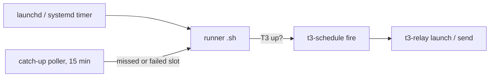

# t3-schedule

`scripts/t3-schedule` (flags: `--help`, `add --help`; tests `scripts/test_*.py`). Install
`scripts/install`; `install --check` also verifies the
[t3-relay](../t3-manage-thread/relay.md) dependency (`t3-relay check`).



Why launchd/systemd and not T3's native `fixed_time` tasks: those skip a run >10 min late
(sleeping Mac); launchd replays the missed slot at wake, the catch-up poller covers the rest.

```bash
t3-schedule add --name nightly --at 07:30 --weekdays --project ~/code/x/app -- "Run the nightly report."
t3-schedule add --name check-deploy --once 2026-10-20 --at 10:00 --resume-thread <threadId> \
  --prompt-file ~/notes/what-to-check.md
t3-schedule list --markdown   # answer "what's scheduled?" with this
```

## Jobs

- **Recurring** (`--weekdays`, `--days mon,thu`, default daily): definition versioned in the repo,
  machine opts in with `adopt`; pause/resume, one-or-many machines → [repo-jobs.md](repo-jobs.md).
- **One-shot** (`--once YYYY-MM-DD`): machine-local, retried until 23:00 that day, then retired
  (`list` shows `fired <date>` / `expired (never fired)`).
- **Continuation** (`--resume-thread ID`): sends the prompt as a turn to that thread ("Scheduled
  follow-up (<date>), as agreed earlier in this thread: …"); settled threads wake. Machine-local,
  usually `--once`. Inside T3 pass **your own id** (`t3_thread_list` → `currentThreadId`); a
  launchd job cannot resolve "self". Arm one whenever the next step needs time to pass (logs,
  cache expiry, deploy soak, a reply). Keep data the prompt needs outside `/tmp`.
  `pending-resumes` lists them; `t3-purge-threads` spares those threads.

## Fire = `t3-relay` (exit 0 = accepted, async, no thread id back)

| job field | relay |
|---|---|
| `project`, `title` (`{date}` → today) | `launch --project --title` |
| `model` (ordered list, e.g. `opus,sol`) | first candidate `t3-pick-instance` can route → `--model`, `--instance`; none → run fails, catch-up retries. Omitted → opus, else sol. haiku/luna refused unless `allow_small_model` (`--allow-small-model`): orchestration already done, e.g. a script decides everything |
| `profile` (label or instance id, machine-local, needs `--model`) | narrows the account choice → `--instance` |
| `thinking` | `--effort` (omitted → house effort) |
| `settle_when_done` | appends the [completion footer](../t3-manage-thread/settle-thread.md) to the prompt (no 🏓 title) |
| `resume_thread` | `send --thread` (model/profile/title/settle refused) |

Without `--settle-when-done` the prompt (or the helper it runs) owns the lifecycle.
`--no-notify` drops the success notification. `run-now <name>` fires through the service
manager and tails the log.

## Contract

- **Once per day**: `<name>.last` written only on relay acceptance; failures notify once per day
  (`<name>.failed`).
- **Catch-up**: LaunchAgent `com.t3-skills.t3-schedule.catch-up` re-kicks a job whose slot passed
  today without a fire, until slot+10h (same day). One job per tick, earliest first, never while
  another runner is active, so capacity is re-read between jobs. Keep slots ≥15 min apart.
- **Waits for T3** up to `--wait-max` min (health endpoint), then fails → catch-up.
- **Provider limits/auth** are the thread's problem, as for any launch
  ([t3-usage-windows](../t3-usage-windows/SKILL.md)).
- Never edit a runner: `add --force` (one) or `refresh` (all; `skills-refresh` runs it).
  `list` flags stale runners.
- Files: runner + state `~/.t3/userdata/scheduled/t3-schedule/<name>.*`, log
  `~/.t3/userdata/logs/t3-schedule.<name>.log`. `ProcessType=Interactive` (Standard clamps CLI calls).

Linux / Windows (WSL, systemd user timers): [linux-wsl.md](linux-wsl.md).
