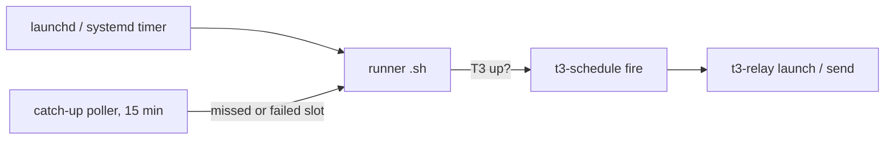

# t3-schedule

North star: a next step that needs time to pass (logs, a deploy, a reply) gets a scheduled
follow-up instead of relying on memory. A recurring job or a one-off wake-up of this thread still
runs on time after the Mac slept, so nobody has to say "check tomorrow".

`scripts/t3-schedule` (`--help`, `add --help`); install `scripts/install`, `--check` also checks
[t3-relay](../t3-manage-thread/relay.md).



Not T3's native `fixed_time` tasks: they skip a run >10 min late (sleeping Mac); launchd replays
the missed slot at wake, the catch-up poller covers the rest.

```bash
t3-schedule add --name check-deploy --once 2026-10-20 --at 10:00 --resume-thread <threadId> \
  --prompt-file ~/notes/what-to-check.md
t3-schedule add --name nightly --at 07:30 --weekdays --project ~/code/x/app -- "Run the nightly report."
t3-schedule list --markdown   # answer "what's scheduled?" with this (finished jobs: --all)
```

## Jobs

- **Continuation** (`--resume-thread ID`, usually `--once`): sends the prompt as a turn to that
  thread ("Scheduled follow-up (<date>), as agreed earlier in this thread: …"); settled threads
  wake. Inside T3 pass **your own id** (`t3_thread_list` → `currentThreadId`); a launchd job
  cannot resolve "self". Arm one whenever the next step needs time to pass (logs, cache expiry,
  deploy soak, a reply). Waiting on someone's reply: one `--once` per workday whose prompt re-arms the next
  one until the reply is there (a temporary chase needs no recurring job). Keep data the prompt needs outside `/tmp`. `pending-resumes` lists them;
  `t3-purge-threads` spares their threads.
- **One-shot** (`--once YYYY-MM-DD`): machine-local, retried until 23:00 that day, then retired
  (`list`: `fired <date>` / `expired (never fired)`).
- **Recurring** (`--weekdays`, `--days mon,thu`, `--monthly 3` = day 1-28, default daily): definition versioned in the repo,
  each machine opts in with `adopt`; pause/resume, one or many machines → [repo-jobs.md](repo-jobs.md).

## Launch options

- `--model opus,astra`: ordered; the first candidate `t3-pick-instance` can route wins; none →
  run fails, catch-up retries. Omitted → opus, else astra. haiku/luna refused unless
  `--allow-small-model` (a script already decides everything).
- `--profile` (label or instance id, machine-local, needs `--model`) narrows the account;
  `--thinking` → effort (omitted → house effort).
- `--settle-when-done` appends the [completion footer](../t3-manage-thread/settle-thread.md);
  otherwise the prompt owns the lifecycle. Continuations refuse model/profile/title/settle.
- `--pre-command CMD` runs before the T3 wait, without T3 (nonzero → one notification per day,
  the fire still follows; the skills updater uses it). `--no-notify` drops the success notification.
- `run-now <name>` fires through the service manager and tails the log.

## Contract

- **Fired = the thread/message exists** (`t3-relay … --wait 120`), not just accepted; `<name>.last`
  is written only then, at most once per day. Failures notify once per day. Accepted but
  unconfirmed → `<name>.pending`: never re-fired (could duplicate); catch-up re-checks
  `t3-relay status`, notifies after 30 min.
- **Catch-up** (`com.t3-skills.t3-schedule.catch-up`) re-kicks a missed or failed slot until
  slot+10h, same day; one job per tick, earliest first, never while another runner is active (so
  capacity is re-read between jobs). Keep slots ≥15 min apart.
- The runner waits for T3 up to `--wait-max` min, then fails → catch-up. Provider limits/auth are
  the thread's problem ([t3-usage-windows](../t3-usage-windows/SKILL.md)).
- Never edit a runner: `add --force` (one) or `refresh` (all; `skills-refresh` runs it). `list`
  flags stale runners.
- Files: `~/.t3/userdata/scheduled/t3-schedule/<name>.*`, log
  `~/.t3/userdata/logs/t3-schedule.<name>.log`. `ProcessType=Interactive` (Standard clamps CLI
  calls to 15–25 s).

Linux / Windows (WSL, systemd user timers): [linux-wsl.md](linux-wsl.md).
